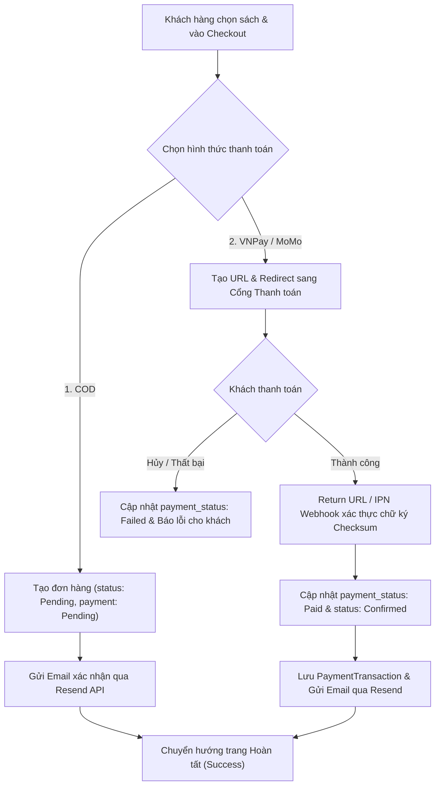

# 📋 KẾ HOẠCH HOÀN THIỆN ĐỒ ÁN MÃ NGUỒN MỞ (MNM BOOKSTORE)
> **Mục tiêu trọng tâm:** Tích hợp Thanh toán Trực tuyến (Online Payment) & Tự động gửi Email xác nhận đơn hàng qua **Resend**.

---

## 📌 TỔNG QUAN HAI TÍNH NĂNG CHÍNH



---

## 🚀 GIAI ĐOẠN 1: TỰ ĐỘNG GỬI EMAIL QUA RESEND

Resend là dịch vụ gửi transactional email thế hệ mới, tích hợp chính thức trong hệ sinh thái Laravel 11, tỷ lệ vào Inbox gần như 100%, miễn phí 3.000 email/tháng (quá đủ cho đồ án và demo).

### Checklist công việc:
- [ ] **1. Đăng ký & lấy API Key Resend:**
  - Truy cập [resend.com](https://resend.com) -> Đăng ký tài khoản (miễn phí).
  - Vào mục **API Keys** -> Tạo API Key mới (quyền `Sending access`) -> Lưu lại key dạng `re_xxxxxxxxxxxx`.
- [ ] **2. Cài đặt Package Resend cho Laravel:**
  - Chạy lệnh:
    ```bash
    composer require resend/resend-laravel
    ```
- [ ] **3. Cấu hình file `.env` & `config/mail.php`:**
  - Cập nhật trong `.env`:
    ```env
    MAIL_MAILER=resend
    RESEND_API_KEY=re_xxxxxxxxxxxxxxxxxxxx
    MAIL_FROM_ADDRESS=onboarding@resend.dev
    MAIL_FROM_NAME="MNM Bookstore"
    ```
    *(Lưu ý: Domain `onboarding@resend.dev` là domain test mặc định của Resend, gửi được tới chính email mà bạn đã dùng đăng ký Resend. Nếu muốn gửi tới email bất kỳ của khách, cần verify 1 custom domain trên Resend hoặc dùng chế độ Sandbox).*
- [ ] **4. Thiết kế Giao diện Email Hóa đơn (Order Invoice Blade View):**
  - Tạo Mailable chuyên nghiệp:
    ```bash
    php artisan make:mail OrderConfirmationMail
    ```
  - Thiết kế template email đẹp mắt chuẩn Responsive ([`resources/views/emails/order_confirmation.blade.php`](file:///Volumes/Hybridd06/Mac_Backup/Documents/HUIT_Nam4/MNM/mnm-bookstore/resources/views/emails/order_confirmation.blade.php)):
    - Logo & Tên nhà sách MNM Bookstore.
    - Lời chào khách hàng, Mã đơn hàng `#MNM-...`, Ngày đặt.
    - Bảng danh sách từng cuốn sách (Hình bìa, tên sách, số lượng, đơn giá, thành tiền).
    - Tạm tính, Phí vận chuyển, Mã giảm giá (nếu có), **Tổng tiền thanh toán**.
    - Địa chỉ giao hàng & Phương thức thanh toán.
    - Nút bấm (CTA): *"Tra cứu đơn hàng"* trỏ về link tra cứu đơn trực tiếp.
- [ ] **5. Tích hợp gửi Mail trong CheckoutController:**
  - Khi đơn hàng tạo thành công (sau `DB::commit()`):
    ```php
    use App\Mail\OrderConfirmationMail;
    use Illuminate\Support\Facades\Mail;

    // Gửi email cho khách hàng
    try {
        Mail::to($order->customer_email)->send(new OrderConfirmationMail($order));
    } catch (\Exception $e) {
        \Log::error('Lỗi gửi email Resend: ' . $e->getMessage());
        // Không throw exception để tránh gián đoạn trải nghiệm mua hàng của khách
    }
    ```
- [ ] **6. Kiểm thử tính năng:**
  - Đặt thử 1 đơn hàng -> Kiểm tra hộp thư đến (Inbox) Gmail.
  - Kiểm tra log và dashboard quản trị tại Resend Dashboard xem status `Delivered`, `Opened`.

---

## 💳 GIAI ĐOẠN 2: THANH TOÁN TRỰC TUYẾN (VNPAY SANDBOX)

VNPay Sandbox là cổng thanh toán trực tuyến tiêu chuẩn tại Việt Nam, cung cấp sẵn môi trường kiểm thử cho ngân hàng nội địa NCB, thẻ quốc tế Visa/Mastercard và quét mã VNPAY-QR.

### Checklist công việc:
- [ ] **1. Đăng ký tài khoản VNPay Sandbox:**
  - Truy cập cổng Sandbox VNPay: [sandbox.vnpayment.vn](https://sandbox.vnpayment.vn/devreg/)
  - Nhận thông tin cấu hình Merchant:
    + `vnp_TmnCode` (Mã website)
    + `vnp_HashSecret` (Chuỗi bí mật tạo mã băm kiểm tra toàn vẹn HMAC-SHA512)
    + `vnp_Url` (`https://sandbox.vnpayment.vn/paymentv2/vpcpay.html`)
- [ ] **2. Cấu hình biến môi trường `.env` & `config/services.php`:**
  - Thêm vào `.env`:
    ```env
    VNPAY_TMN_CODE=XXXXXXXX
    VNPAY_HASH_SECRET=XXXXXXXXXXXXXXXXXXXXXXXXXXXXXXXX
    VNPAY_URL=https://sandbox.vnpayment.vn/paymentv2/vpcpay.html
    VNPAY_RETURN_URL="${APP_URL}/checkout/vnpay/return"
    ```
  - Cấu hình trong `config/services.php`:
    ```php
    'vnpay' => [
        'tmn_code' => env('VNPAY_TMN_CODE'),
        'hash_secret' => env('VNPAY_HASH_SECRET'),
        'url' => env('VNPAY_URL'),
        'return_url' => env('VNPAY_RETURN_URL'),
    ],
    ```
- [ ] **3. Xây dựng VNPay Service (`app/Services/VNPayService.php`):**
  - Hàm `createPaymentUrl(Order $order, string $ipAddress): string`:
    + Chuẩn bị tham số (`vnp_Version`, `vnp_TmnCode`, `vnp_Amount`, `vnp_Command`, `vnp_CreateDate`, `vnp_CurrCode`, `vnp_IpAddr`, `vnp_Locale`, `vnp_OrderInfo`, `vnp_OrderType`, `vnp_ReturnUrl`, `vnp_TxnRef`).
    + Sắp xếp tham số theo alphabet (`ksort`).
    + Tạo chữ ký bảo mật SHA512 (`hash_hmac('sha512', $hashdata, $vnp_HashSecret)`).
    + Trả về URL chuyển hướng khách sang VNPay.
  - Hàm `verifySecureHash(array $vnpayData): bool`:
    + Kiểm tra tính hợp lệ của dữ liệu phản hồi từ VNPay để chống giả mạo thông tin thanh toán.
- [ ] **4. Tạo Controller xử lý phản hồi VNPay (`app/Http/Controllers/Client/PaymentController.php`):**
  - Route Return URL (Khách được chuyển hướng về sau khi thanh toán):
    + Kiểm tra chữ ký `verifySecureHash`.
    + Nếu mã phản hồi `vnp_ResponseCode == '00'`:
      * Cập nhật `order->payment_status = 'paid'`.
      * Cập nhật `order->status = 'confirmed'`.
      * Ghi log vào bảng `payment_transactions` (`provider: 'vnpay'`, `transaction_id: vnp_TransactionNo`, `amount`, `status: 'success'`).
      * Gửi email xác nhận thanh toán & đơn hàng thành công qua Resend.
      * Redirect về trang thành công `route('checkout.success', $order->order_number)`.
    + Nếu thanh toán thất bại / khách bấm hủy:
      * Cập nhật `order->payment_status = 'failed'`.
      * Redirect về trang thanh toán hoặc chi tiết đơn hàng kèm thông báo lỗi rõ ràng.
  - Route IPN (Instant Payment Notification - Server-to-Server Webhook):
    + Nhận webhook từ server VNPay chạy ngầm để đảm bảo đơn hàng vẫn được cập nhật `paid` ngay cả khi khách vô tình tắt trình duyệt.
- [ ] **5. Cập nhật giao diện Checkout (`checkout/index.blade.php`):**
  - Bổ sung tùy chọn phương thức thanh toán:
    * 🔘 **Thanh toán khi nhận hàng (COD)**
    * 🔘 **Cổng thanh toán VNPAY (ATM Nội địa, QR Pay, Visa/Mastercard)**
    * 🔘 **Chuyển khoản ngân hàng trực tiếp (VietQR)**
  - Hiển thị logo VNPay / icon thẻ ngân hàng trực quan.
- [ ] **6. Dữ liệu thẻ test ngân hàng NCB của VNPay Sandbox:**
  - Ngân hàng: `NCB`
  - Số thẻ: `9704198526191432198`
  - Tên chủ thẻ: `NGUYEN VAN A`
  - Ngày phát hành: `07/15`
  - Mật khẩu OTP: `123456`

---

## 🔗 GIAI ĐOẠN 3: TỔNG HỢP KIỂM THỬ VÀ ĐÓNG GÓI BẢO VỆ

- [ ] **1. Viết Feature Test:**
  - Test thanh toán VNPay callback hợp lệ -> Đơn chuyển sang `paid`.
  - Test callback sai chữ ký Hash -> Bị từ chối (bảo mật).
  - Test gửi email đơn hàng qua Resend Mailer.
- [ ] **2. Xử lý tồn kho an toàn:**
  - Đảm bảo khi tạo đơn hàng thanh toán online, sách được giữ chỗ tạm thời trong kho.
  - Nếu sau 15-30 phút không thanh toán hoặc giao dịch thất bại -> Admin hoặc Scheduled Task tự động hủy đơn và hoàn trả tồn kho.
- [ ] **3. Chuẩn bị tài liệu & slide bảo vệ:**
  - Sơ đồ tuần tự (Sequence Diagram) luồng thanh toán VNPay HMAC-SHA512.
  - Trình bày kiến trúc gửi Mail qua API Resend (tại sao chọn API thay cho SMTP truyền thống).

---

## 🎯 TIẾN ĐỘ THỰC HIỆN ĐỀ XUẤT

| Ngày / Buổi | Nhiệm vụ chính | Kết quả đạt được |
| :--- | :--- | :--- |
| **Buổi 1** | Tích hợp **Resend Email** | Gửi email kích hoạt đơn hàng đẹp mắt ngay sau khi checkout |
| **Buổi 2** | Tích hợp **VNPay Service & Return URL** | Khách thanh toán bằng thẻ NCB Sandbox thành công, tự cập nhật DB |
| **Buổi 3** | Xử lý **IPN Webhook & Lưu Transaction** | Hoàn thiện bảng `payment_transactions`, chống hack số tiền |
| **Buổi 4** | Test toàn diện & Tối ưu UI/UX | Viết unit test, chạy thử toàn bộ luồng từ giỏ hàng -> VNPay -> Email |

---
*Kế hoạch được biên soạn riêng cho đồ án MNM Bookstore tại thư mục: `/Volumes/Hybridd06/Mac_Backup/Documents/HUIT_Nam4/MNM`*
